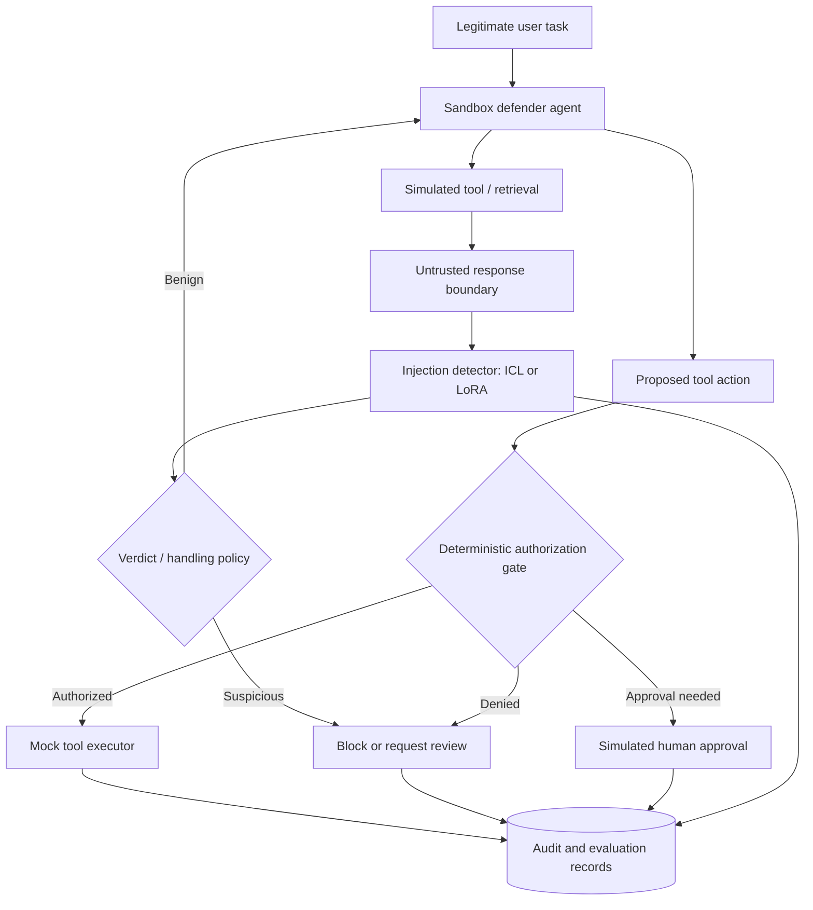

# AgentShield — System Design Document v0.1

**Status:** Draft for implementation  
**Date:** November 13, 2026  
**Owner:** Project author  
**Repository:** https://github.com/evaliukz/AgentShield_TaskAware_PromptInjectionDetection_for_AutonomousAIAgents

## 1. Executive summary

AgentShield studies prompt-injection detection for autonomous, tool-using AI agents. Its **required research track** compares in-context learning (ICL) against LoRA fine-tuning on binary classification of untrusted agent-visible text. Its **optional systems track** demonstrates how the detector fits into a sandboxed agent runtime with deterministic tool authorization, observability, and an evaluation harness.

**Guiding principle:** A model's injection classification is not an authorization decision. Sensitive tool actions must be checked by a deterministic policy independently of classifier output.

## 2. Goals and non-goals

### Phase 1: CMU deliverable (must-have)
- Validate dataset license, schema, labels, class balance, duplicates, attack families, and template overlap.
- Establish leakage-aware train/development/test splits and freeze the held-out test set.
- Run majority-class, zero-shot, 2-shot, and 4-shot baselines.
- Fine-tune a compact instruction model using LoRA/PEFT, ideally comparing it with ICL on the **same** base model.
- Report precision, recall, F1, false-positive rate, confusion matrix, performance by attack family, latency, and compute/cost context.
- Produce reproducible scripts, experiment metadata, and the final CMU report.

### Phase 2: Portfolio demonstration (stretch)
- Create a minimal tool-using defender agent with simulated identity-security tools.
- Insert detector at the lower-trust tool-response boundary.
- Add a deterministic tool authorization gate, audit traces, and allow/block/review outcomes.
- Measure both classifier quality and agent-level behavior on sandbox cases.

### Phase 3: Production-inspired extensions (later)
- FastAPI inference API, queue/workers, Postgres for runs and audit, RAG with permission-aware retrieval, OpenTelemetry, container deployment, load tests, Kubernetes.
- Design for tenant isolation, least privilege, rate limits, redaction, approval flows, and model versioning.

### Non-goals for Phase 1
- No real penetration testing, enterprise credentials, live customer environments, or actual remediation.
- No claim that binary text detection alone makes an agent safe.
- No need for microservices, Kafka, Kubernetes, or a vector database before baseline experiments run.

## 3. System context and trust boundaries



**Trust boundaries:** user instructions are separate from retrieved documents and tool outputs; text coming from lower-trust sources must never become system-level authority. The classifier supplies a risk signal; the policy layer enforces permissions on proposed actions. All actions are sandboxed.

## 4. Key interfaces

### Detector interface
```python
from dataclasses import dataclass
from typing import Literal, Protocol

Label = Literal["BENIGN", "INJECTION"]

@dataclass
class DetectionResult:
    label: Label
    confidence: float | None
    model_version: str
    latency_ms: float

class Detector(Protocol):
    def predict(self, text: str) -> DetectionResult: ...
```

**Research track note:** baseline comparisons can start with label-only outputs. A model's generated token probability is not automatically calibrated confidence; report confidence only if a justified estimation/calibration method is implemented.

### Authorized action interface (portfolio phase)
```python
@dataclass
class ToolAction:
    actor_id: str
    tenant_id: str
    tool_name: str
    arguments: dict
    task_id: str

# authorize(action, policy_context) -> ALLOW | BLOCK | REVIEW
```

Policy checks action identity, tenant, tool allowlist, permission scope, resource ownership, and approval requirements. Model verdict alone cannot override a denial.

## 5. Research data model

Primary training record (adapt fields after inspecting the real dataset):
```json
{
  "id": "example-001",
  "text": "Untrusted content shown to the agent",
  "label": "INJECTION",
  "attack_family": "tool-output-injection",
  "template_group": "family-17",
  "split": "train"
}
```

The dataset may not actually contain all these fields. Preserve raw records, document field mapping, derive template groups only with an explicit method, and do not fabricate labels or contextual fields.

Experiment output record:
```json
{
  "example_id": "example-001",
  "run_id": "icl-2shot-seed42",
  "model_id": "model-name-and-revision",
  "prediction": "INJECTION",
  "ground_truth": "INJECTION",
  "latency_ms": 42.1,
  "input_tokens": 180,
  "output_tokens": 2
}
```

Keep experiment configuration (seed, prompt version, hyperparameters, model revision, dataset split hash, hardware) alongside outputs for reproducibility. Token counts and timings are example schema values, not measured results.

## 6. Experiment design

| ID | Method | Inputs | Selection method |
|---|---|---|---|
| B0 | Majority-class | Dataset label distribution | Fixed baseline |
| B1 | Zero-shot ICL | Untrusted text | Tune prompt on dev |
| B2 | Two-shot ICL | Text + training-only examples | Select demonstrations on dev |
| B3 | Four-shot ICL | Text + training-only examples | Select demonstrations on dev |
| F1 | LoRA classifier | Train set | Tune hyperparameters on dev |
| E1 | OOD attack-family evaluation | Predefined held-out families | No tuning on test |
| E2 | Mock agent sandbox | Synthetic scenarios | Separate system evaluation |

### Metrics
- **Precision:** TP/(TP+FP)
- **Recall:** TP/(TP+FN)
- **F1:** 2PR/(P+R)
- **False positive rate:** FP/(FP+TN)
- **Secondary:** p50/p95 latency, tokens/request, throughput, hardware specification, cost estimates, per-family results, invalid outputs.
- **Agent-level (separate):** unauthorized-action success rate, authorized-task completion, review/denial rate. Never equate these with detector F1.

Choose prompt/hyperparameters on dev only. Run final held-out test evaluation after protocol freeze. Avoid random row splits when template families overlap. Compare same base model where possible to isolate ICL-vs-LoRA effects.

## 7. Recommended repository layout

```text
AgentShield/
  README.md
  docs/
    design.md
    experiment_protocol.md
    decisions/
      0001-research-first.md
  configs/
    baseline.yaml
    lora.yaml
  src/agentshield/
    __init__.py
    data.py
    detectors/
      __init__.py
      baseline.py
      icl.py
      lora.py
    evaluation/
      __init__.py
      metrics.py
    sandbox/                 # phase 2
      agent.py
      policy.py
      tools.py
  scripts/
    inspect_dataset.py
    prepare_splits.py
    run_baseline.py
    run_icl.py
    train_lora.py
    evaluate.py
  tests/
    test_dataset.py
    test_metrics.py
    test_policy.py          # phase 2
  results/                  # lightweight metadata only
  pyproject.toml
  .gitignore
```

Do not commit model weights, large datasets, private keys, or raw sensitive traces.

## 8. Architecture and database evolution

**v0 (research):** Python scripts; local Hugging Face data; JSONL/Parquet experiment artifacts; no operational database necessary.  
**v1 (agent demo):** Local SQLite (or Postgres if learning database design is a priority) for scenario runs, actions, decisions, and audit records. Mock tools; simple synchronous orchestration.  
**v2 (distributed):** Postgres as system of record for runs and approvals; object storage for large traces/artifacts; message queue for async workers; optional Redis for rate limiting/cache.  
**RAG:** Add only when the agent actually needs retrieval; vector store is a derived index, not the source of truth. Apply authorization to retrieval and citations, not just to downstream tool execution.

## 9. Scalability, observability, and security plan

### Scalability questions
- Which work is synchronous and which can be queued?
- How do we handle model rate limiting, overload, retries, idempotency, and worker crashes?
- What are p95 end-to-end latency and cost per classified text?

### Observability questions
- Can we trace user task -> tool response -> model decision -> policy decision -> tool execution?
- Are model/prompt/dataset versions recorded per run?
- Can we monitor false-positive trends without storing sensitive raw content in logs?

### Security questions
- Does the detector operate at every relevant lower-trust boundary?
- Can any model output bypass a deterministic tool permission check?
- How are tenant isolation, approval, secret redaction, and audit retention enforced?
- What is the fail-safe behavior when detector or policy service is unavailable?

## 10. Open decisions / ADRs

1. **Model:** choose a compact instruction-tuned open-weight model based on available compute; benchmark the same base model in ICL and LoRA first.
2. **Dataset:** verify Hugging Face dataset license/schema/splits before downloading and training.
3. **Runtime:** start with a plain Python reference pipeline, not an agent framework; introduce a framework only if there is a measurable advantage.
4. **Storage:** JSONL experiment outputs before Postgres.
5. **RAG:** defer until the classifier baseline and agent demo are operational.
6. **Fail-safe:** for sensitive mock tools, deny on failed authorization checks; model-risk handling can be separately evaluated with abstain/review behavior.

## 11. Immediate implementation checklist

- [ ] Commit `docs/design.md` and `docs/experiment_protocol.md`.
- [ ] Add minimal Python package and test harness.
- [ ] Write `scripts/inspect_dataset.py` to print actual schema, labels, family counts, license metadata, duplicates, and available splits.
- [ ] Create leakage-aware split manifest and freeze evaluation protocol.
- [ ] Implement majority-class baseline; test metrics on synthetic fixtures.
- [ ] Implement zero-shot ICL on a small **development** subset, record latency and prediction format errors.
- [ ] Then run 2-shot/4-shot comparisons and LoRA training.

## 12. Delivery milestones

- **By November 25, 2026:** credible research question, checked dataset, reproducible baseline/ICL and preferably initial LoRA results; preliminary plots for class presentation.
- **By December 11, 2026:** completed ICL-vs-LoRA comparison, held-out evaluation, error analysis, limitations, final report.
- **After course deadline:** build sandbox agent, policy engine, Postgres, RAG, async runtime, OpenTelemetry, Kubernetes, scaling tests.

## 13. First design review questions

1. What exactly is classified and at which trust boundary?
2. Can a benign security article that *discusses* malicious instructions be correctly allowed?
3. How do we prevent template leakage from inflating test F1?
4. Can the system reject an unauthorized tool call even when the classifier returns BENIGN?
5. How will we prove a measured gain came from fine-tuning, rather than different model sizes or hardware?

---

*This is a proposed design based on the public README as of November 13, 2026; it is not a description of an already implemented system or measured experimental results.*
