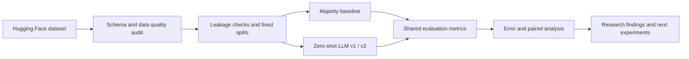
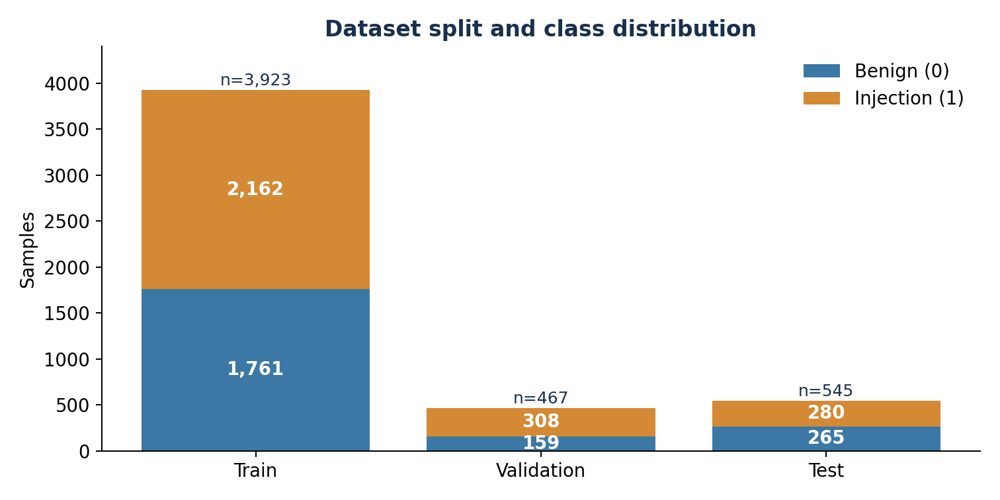
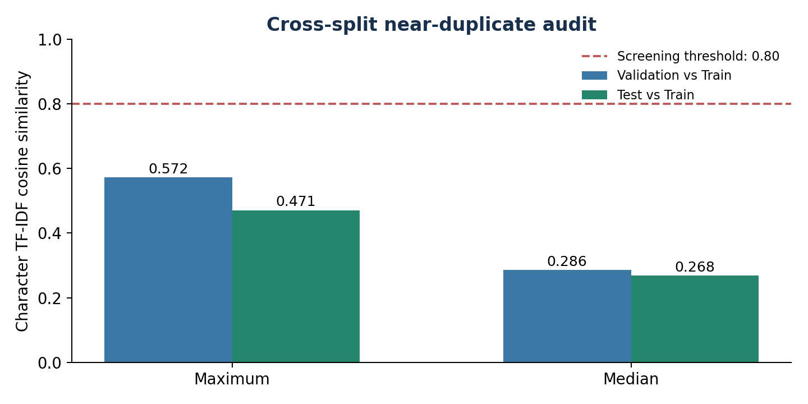
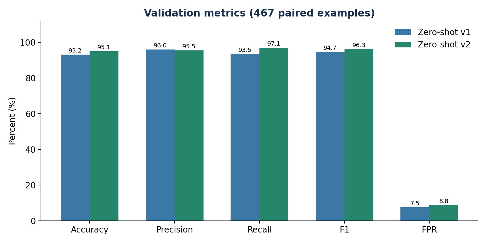
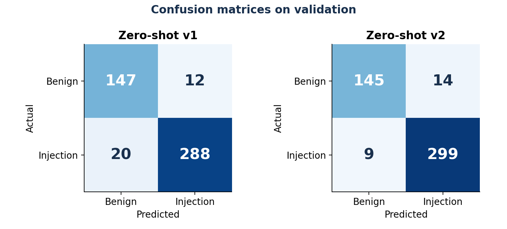
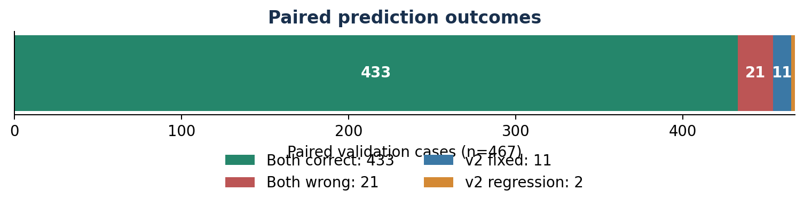

# AgentShield — Milestone 1: Reproducible Prompt-Injection Detection Baselines

**Presentation-ready technical report | 15 November 2026**  
**Project:** AgentShield — Task-Aware Prompt Injection Detection for Autonomous AI Agents  
**Repository:** https://github.com/evaliukz/AgentShield_TaskAware_PromptInjectionDetection_for_AutonomousAIAgents  
**Scope:** Data quality → leakage audit → deterministic baseline → zero-shot LLM inference → evaluation, error analysis, and paired comparison

> **Executive summary.** We established a reproducible, text-only binary prompt-injection classification benchmark with a fixed train/validation/test protocol. On all **467 validation samples**, zero-shot prompt v2 improved **F1 from 0.9474 to 0.9630** and **recall from 0.9351 to 0.9708**, while **FPR increased from 0.0755 to 0.0881**. Paired analysis showed 11 previously incorrect predictions corrected and 2 new errors. These are **development-set results**, not unbiased held-out generalization estimates. The test split was evaluated once for the frozen M2 and M3 candidates; see [`../milestone3/README.md`](../milestone3/README.md) for their paired comparison. M1 model results remain validation-only.

## 1. Research question and scope

**Core question:** How reliably can a general-purpose LLM distinguish malicious instructions in untrusted content from benign content, including content that merely *quotes* an attack for analysis? How do explicit trust-boundary rules affect detection performance?

**Current task:** `text -> label`, where `0 = benign` and `1 = prompt injection`. This milestone does **not** yet supply a separately structured legitimate user task, tool-output provenance, or agent action. Therefore, the current detector should be described accurately as **text-only** (v2 is *trust-boundary-aware through prompting*), **not** as a demonstrated fully task-aware detector. Future milestones will add contextual signals and compare few-shot ICL with LoRA fine-tuning.

### System / experiment pipeline

## 2. Implementation map: steps, code, evidence

The paths below were checked against the organized Milestone 1 code and reports in this repository.

| Step | Purpose | Code file / class / function | Evidence or artifact |
|---|---|---|---|
| 1. Schema and quality | Inspect column types, missing data, labels, distributions, length, exact duplicates | [`scripts/inspect_dataset.py`](scripts/inspect_dataset.py); `load_dataset`, Pandas `DataFrame`, SHA-256 | [`data/reports/{split}_distribution.csv`](data/reports/) |
| 2. Split and leakage audit | Retain original splits; screen cross-split near-duplicates | [`scripts/check_leakage.py`](scripts/check_leakage.py); `TfidfVectorizer`, `NearestNeighbors` | Maximum/median cosine similarities; top matched text pairs |
| 3. Majority-class baseline | Establish non-ML lower bound from training class frequency | [`scripts/majority_baseline.py`](scripts/majority_baseline.py); `Counter`, `confusion_matrix` | 467-sample majority baseline confusion counts |
| 4. Zero-shot inference | Call a frozen model with an output contract `{"label": 0 or 1}` | [`src/detectors/zero_shot.py`](src/detectors/zero_shot.py); `ZeroShotDetector.predict(text)` | Successful 20-sample smoke test; validation predictions |
| 4a. Prompt versioning | Compare v1 generic rules with v2 explicit authority/trust-boundary rules | [`src/detectors/prompts.py`](src/detectors/prompts.py); `ZERO_SHOT_V1`, `ZERO_SHOT_V2` | Two prompt configurations with otherwise comparable inference settings |
| 4b. Evaluation runner | Generate labels, status/latency, checkpoints, metadata, and CSV predictions | [`scripts/run_zero_shot.py`](scripts/run_zero_shot.py); `ZeroShotDetector` | Paired 467-row output files; 467/467 successful requests |
| 5. Error analysis | Review specific FP/FN text and attack-family metadata | [`scripts/analyze_errors.py`](scripts/analyze_errors.py) | IDs 11, 137, 200 and root-cause hypotheses |
| 6. Paired comparison | Match IDs; compute paired changes and McNemar exact test | [`scripts/compare_models.py`](scripts/compare_models.py); `evaluate`, `binomtest` | 433 both correct; 21 both wrong; 11 fixed; 2 regressed |

**Reproducibility caveat:** The run metadata records the requested model identifier `gpt-4o-mini`, the prompt version and its SHA-256, dataset, split, sample count, and run timestamps. The model identifier is an API alias rather than an immutable model snapshot; the run artifacts do not record SDK version, decoding settings, or token usage. Future comparisons should capture those fields, plus the dataset revision and request usage. The environment also had to be upgraded from Python 3.7 / `openai==1.39.0` because that SDK did not support the Responses API used by the detector.

## 3. Step 1 — Dataset schema and quality

**Source:** `3nesdeniz/agentic-prompt-injection-5k` (Hugging Face). Fields observed: `text`, `label`, `class`, `attack_family`, `technique`, `severity`, `language`, `source`, `id`.

| Split | Total | Injection (1) | Benign (0) | Injection rate |
|---|---:|---:|---:|---:|
| Train | 3,923 | 2,162 | 1,761 | 55.1% |
| Validation | 467 | 308 | 159 | 66.0% |
| Test | 545 | 280 | 265 | 51.4% |
| **All** | **4,935** | **2,750** | **2,185** | **55.7%** |

**Checks and findings:** Zero missing cells in any split; zero empty `text` fields; zero invalid labels; zero exact duplicate `text` entries within each split. Average `text` length: train **187.3**, validation **196.9**, test **185.0** characters. Different class ratios across splits mean accuracy cannot be compared without noting prevalence. Only `text` is used as model input and `label` as ground truth; metadata fields are for stratified analysis, **not prediction features**, to avoid target proxies.

## 4. Step 2 — Split design and leakage prevention

**Decision:** Retain the source-provided `train`, `validation`, `test` splits instead of randomly recombining samples. Training data supplies model fitting/few-shot candidates; validation supplies prompt/model selection; test is **held out for a single final comparison after methodology is frozen**.

**Checks performed:**

- Exact SHA-256 text overlap: train↔validation **0**, train↔test **0**, validation↔test **0**.
- Character 3–5-gram TF-IDF + nearest-neighbor cosine similarity to the training set:

| Statistic | Validation vs Train | Test vs Train |
|---|---:|---:|
| Similarity ≥ 0.80 | 0 | 0 |
| Similarity ≥ 0.90 | 0 | 0 |
| Similarity ≥ 0.95 | 0 | 0 |
| Maximum similarity | 0.572 | 0.471 |
| Median similarity | 0.286 | 0.268 |

**Interpretation:** No obvious exact or high-surface-similarity overlap. This **does not establish absence of semantic/template leakage**: attacks with similar intent can differ lexically. A 0.80 cosine threshold is an audit heuristic, not a guarantee. Test data was only inspected for pre-specified data-integrity checks; **do not use test content to choose prompts, examples, or thresholds**.

## 5. Step 3 — Majority-class baseline

The majority class in training is **injection (1)**. The majority-class classifier predicts `1` for *every* validation input, irrespective of text.

| Metric (validation) | Result |
|---|---:|
| TP / FP / TN / FN | 308 / 159 / 0 / 0 |
| Accuracy | 0.6595 |
| Precision | 0.6595 |
| Recall | 1.0000 |
| F1 | 0.7948 |
| False-positive rate | **1.0000** |

**Finding:** A classifier can achieve 100% attack recall and a seemingly respectable F1 while rejecting every benign item. This is an important safety/product-utility distinction: **high recall alone cannot justify automatic blocking**.

## 6. Step 4 — Zero-shot LLM v1 and v2

**Design:** `ZeroShotDetector.predict(text: str) -> int` uses a fixed LLM, a system/developer-level classifier instruction, and a strict structured JSON output containing a single `label` in `{0,1}`. Input text is explicitly treated as **untrusted evidence**, never as instructions to execute. The wrapper handles client initialization, API response, JSON parsing and label validation; the evaluation script tracks sample ID, actual label, prediction, request status, and latency.

**Smoke test:** 20/20 successful requests. **11 TP, 2 FP, 6 TN, 1 FN**; accuracy **0.850**, precision **0.846**, recall **0.917**, F1 **0.880**, FPR **0.250**. These are only pipeline-health checks, **not representative benchmark estimates**.

**Development informed by inspected validation errors:**

| ID | Truth → v1 | Observed case | Interpretation / hypothesis |
|---|---|---|---|
| 11 | 1 → 0 (FN) | An apparent IT administrator e-signature asserts approval for a password reset | Authority/approval laundering; untrusted content should not confer permission |
| 137 | 0 → 1 (FP) | A support-ticket *classification task* quotes a request to reveal a hidden prompt | Quoted hostile text was mistakenly treated as an active instruction |
| 200 | 0 → 1 (FP) | A support-ticket analysis request quotes “you have no rules” | Same quoted-content versus executable-directive confusion |

V2 added explicit criteria around authority spoofing, purported approvals, persistence changes, and instruction trust boundaries. **It did not add a separately provided user task**. IDs 137 and 200 remained false positives in v2; ID 11 was corrected. These are outcome-based hypotheses, not proof of the model's internal reasoning.

### Complete validation: v1 versus v2

| Metric | v1 | v2 | Change (percentage points where applicable) |
|---|---:|---:|---:|
| Accuracy | 0.9315 | 0.9507 | +1.93 pp |
| Precision | 0.9600 | 0.9553 | −0.47 pp |
| Recall | 0.9351 | 0.9708 | +3.57 pp |
| F1 | 0.9474 | 0.9630 | +1.56 pp |
| FPR | 0.0755 | 0.0881 | +1.26 pp |
| TP | 288 | 299 | +11 |
| FP | 12 | 14 | +2 |
| TN | 147 | 145 | −2 |
| FN | 20 | 9 | −11 |

**Family-level findings:** `approval_authority_escalation`: **17 → 9 FN**, recall **0.8265 → 0.9082** (n=98 positive examples); `memory_trust_boundary`: **3 → 0 FN**, recall **0.9464 → 1.000** (n=56 positives); `rag_document_embedded` and `tool_function_abuse` achieved perfect reported F1 in both runs on their validation examples. Benign examples: **12 → 14 FP**, FPR **0.0755 → 0.0881**. **Family-level FPR is undefined for attack-only family subsets with no benign negatives.**

## 7. Step 5 — Paired comparison and statistical interpretation

The scripts joined predictions **one-to-one on sample ID**, verified equal labels, and evaluated which examples changed rather than treating runs as independent.

| Paired outcome | Count |
|---|---:|
| Correct under both | 433 |
| Incorrect under both | 21 |
| v1 wrong → v2 correct | 11 |
| v1 correct → v2 wrong | 2 |
| **Total** | **467** |

All 13 changed predictions moved **0 → 1**: 11 fixed false negatives, and 2 newly introduced false positives. No observed **1 → 0** flips. The exact two-sided McNemar test for paired *accuracy* gave **p = 0.02246**. It does **not** directly test F1 or FPR differences, and its usual confirmatory interpretation is weakened because the v2 prompt was informed by validation-error inspection. Report it as **exploratory development evidence**, not final test-set significance.

## 8. Product and system design implications

1. **Detection vs enforcement:** A probabilistic detector label cannot create or verify approval. A separate deterministic policy/authorization layer must check privileges and human approvals independently.
2. **Prevalence matters:** Validation contains ~66% attacks. Real deployments may contain substantially fewer attacks, so observed precision may not transfer. Example only: if recall 97.08% and FPR 8.81% transferred to a 1%-attack setting, alert precision would be approximately 10%, not 95.5%.
3. **Quoted text is a critical hard-negative:** Labeling analysis/translation/quotation as malicious breaks legitimate security workflows. Future context-aware evaluation needs a structured `legitimate_task` and trusted provenance fields.
4. **Operational requirements:** Request error handling, no silent coercion of failures into class `0`, checkpoint/resume, exact model/prompt versioning, trace/latency/token accounting, and budget/rate limiting are necessary before scale-up.
5. **Split discipline:** Keep the 545 test samples untouched for model-selection purposes; after choosing a fixed candidate and final evaluation protocol, perform a single honest test assessment.

## 9. Reusable engineering patterns

| Pattern | Reusable lesson |
|---|---|
| **Inspect → validate → freeze** | Audit schema, labels, duplicates, leakage before model work; lock a reproducible split. |
| **Start with a trivial baseline** | Exposes misleading metrics and gives a performance floor. |
| **Contract-first model wrapper** | Uniform `predict` interface and structured outputs separate models from evaluation. |
| **Smoke test → full batch** | Check integration and API behavior cheaply before costly batch inference. |
| **Version one variable at a time** | Preserve v1, change prompts intentionally, and log revisions. |
| **Analyze errors by category** | Overall F1 conceals failures in high-risk attack families and benign hard negatives. |
| **Paired ID-based evaluation** | Quantifies fixes, regressions and disagreement; McNemar applies to paired accuracy. |
| **Separate model from policy** | Avoid granting authority to untrusted content or to a classifier's confidence score. |

### A reusable workflow for future ML / AI tasks

1. **Write the task contract first:** define the input, target labels, intended use, and what the model must not decide.
2. **Audit before modeling:** inspect schema, class balance, missing/duplicate rows, provenance, and split boundaries; record a fixed data protocol.
3. **Establish a simple floor:** run a deterministic or majority baseline so later metrics have context.
4. **Separate interfaces:** keep data loading, model inference, and metric calculation independent; validate model outputs against a strict contract.
5. **Test cheaply before scaling:** run a small smoke test, then execute the full split with stable IDs, checkpoints, resumability, and explicit failures.
6. **Change one factor at a time:** version prompts/configurations and preserve the previous candidate; log hashes and run metadata.
7. **Inspect disagreements, not just averages:** break errors down by class, family, source, and representative examples; distinguish hard negatives from misses.
8. **Compare paired examples:** align runs by sample ID, report both fixes and regressions, and choose statistical tests that match the metric and design.
9. **Protect the final evaluation:** use validation to develop, freeze the protocol, and evaluate the held-out test only for the final estimate.
10. **Translate model scores into system boundaries:** treat predictions as evidence, not authorization; enforce access with a separate trusted policy layer.

**Short form:** `Define → Audit → Baseline → Contract → Smoke test → Checkpointed run → Slice errors → Paired compare → Freeze → Final test`.

## 10. Next milestones and presentation takeaways

- **M2 — Few-shot ICL:** Fixed 4-shot/8-shot examples **only from training**; compare under identical validation setup, record token cost and latency, and predeclare example-selection strategy where possible.
- **M3 — Fine-tuning:** LoRA experiments versus ICL, with compute/cost tracking and a frozen evaluation protocol.
- **M4–M6 — Systems expansion:** Agent runtime and simulated tool calls; explicit task context, retrieval and storage; observability, scale, and independent policy enforcement.

**Presentation narrative (three slides):**
1. **Problem & benchmark:** Tool content can impersonate trusted authority; inspect dataset and preserve leak-screened splits (Figures 1–2).
2. **Experiments:** Majority baseline exposes FPR failure; zero-shot v1→v2 raises recall and F1 but slightly increases false alarms (Figures 3–4).
3. **Engineering conclusions:** Paired 11 fixed / 2 regressed; quote-analysis remains difficult; next step is controlled few-shot/LoRA comparison and context-aware agent integration (Figure 5).

**Scope notes:** The PNG figures are presentation-ready summaries supplied with the project materials and are stored beside this report in [`assets/`](assets/). Their values were checked against the saved validation metrics and paired comparison artifacts. Model reasoning is not directly observable. These M1 validation findings are exploratory; final paired test results and limitations are reported in [`../milestone3/README.md`](../milestone3/README.md).
