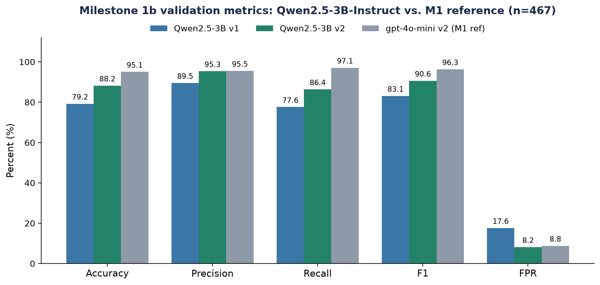
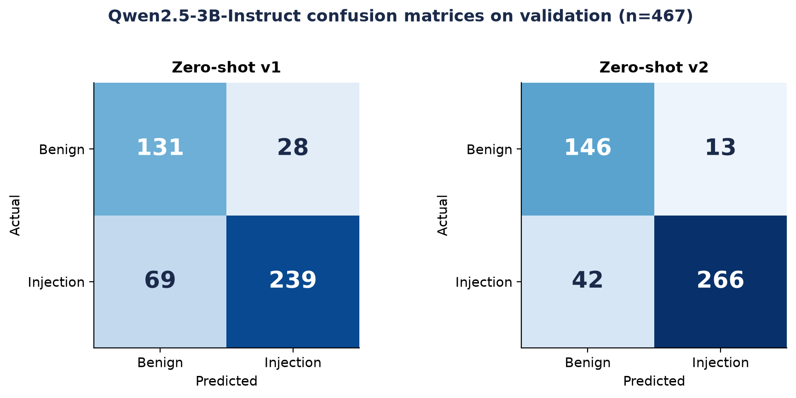
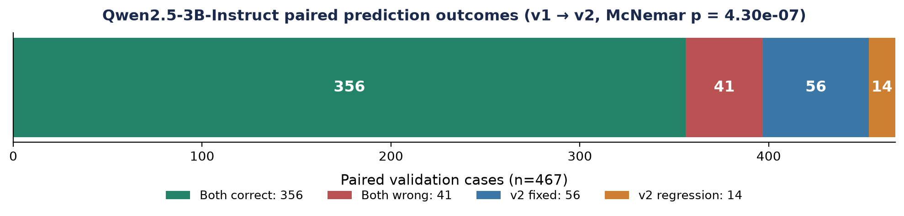
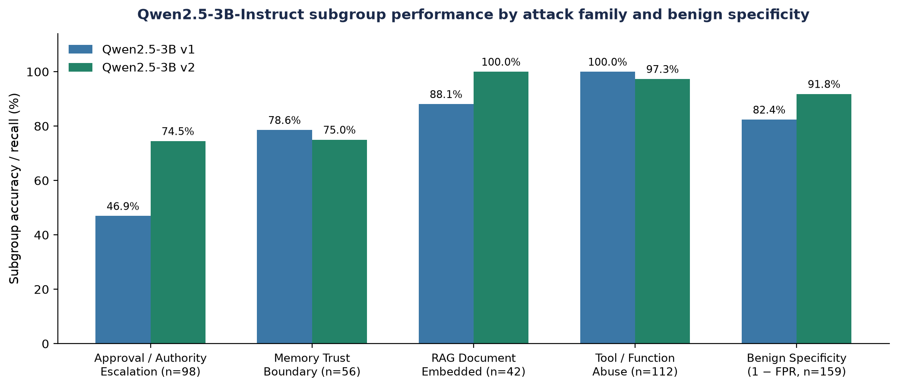

# AgentShield — Milestone 1b: Open-Weight Zero-Shot Baseline (`Qwen2.5-3B-Instruct`)

**Technical report | 22 November 2026**  
**Project:** AgentShield — Task-Aware Prompt Injection Detection for Autonomous AI Agents  
**Repository:** https://github.com/evaliukz/AgentShield_TaskAware_PromptInjectionDetection_for_AutonomousAIAgents  
**Scope:** Local open-weight zero-shot evaluation (`Qwen/Qwen2.5-3B-Instruct`, v1 vs. v2) + Milestone 1 reproducibility hardening

> **Executive summary.** To enable a controlled, same-base-model comparison across Zero-Shot (M1b), Few-Shot ICL (M2), and LoRA Fine-Tuning (M3), we added a local Hugging Face detector backend and evaluated `Qwen/Qwen2.5-3B-Instruct` on all **467 validation samples** using the unchanged Milestone 1 prompts (`v1` and `v2`). Prompt `v2` improved **F1 from 0.8313 to 0.9063 (+7.50 pp)** and **recall from 0.7760 to 0.8636 (+8.77 pp)** while **cutting FPR by more than half from 0.1761 to 0.0818 (−9.43 pp)**. Paired analysis recorded **56 fixes** and **14 regressions** (exploratory exact two-sided McNemar `p = 4.30e-07` on dev). All 934 inferences returned strict schema-compliant JSON (`0` errors). The 545-sample test split remains sealed.

## 1. Motivation and scope

Milestone 1 established a commercial API reference with `gpt-4o-mini` (`v2` validation F1 `0.9630`, Recall `0.9708`, FPR `0.0881`). However, two research requirements motivate an open-weight Milestone 1b baseline before Milestone 2 (Few-Shot ICL) and Milestone 3 (LoRA):

1. **Controlled ICL-vs-LoRA attribution:** Comparing ICL on closed-weight `gpt-4o-mini` against LoRA on an open-weight model confounds training method with model family and size. Benchmarking `Qwen/Qwen2.5-3B-Instruct` here establishes a single frozen base model for `0-shot → 4-shot → 8-shot → LoRA` under identical hardware and decoding settings, while keeping `gpt-4o-mini` as the commercial reference.
2. **Clear experimental headroom:** `gpt-4o-mini` v2 already sits at `0.9630` F1 (only 23 validation errors), leaving limited room to measure adaptation gains. `Qwen/Qwen2.5-3B-Instruct` v2 leaves 55 well-structured validation errors (`42 FN`, `13 FP`) across specific techniques, creating clean diagnostic targets for M2 and M3.

As in Milestone 1, this remains a **text-only** binary classification benchmark (`0 = benign`, `1 = prompt injection`) on `3nesdeniz/agentic-prompt-injection-5k`. All results are **validation-set development findings**; the 545-sample test split was not evaluated.

## 2. Implementation and reproducibility hardening

Milestone 1b addresses Milestone 1 step 7 (reproducibility hardening) while preserving full backward compatibility with the OpenAI pipeline:

| Component | Path | Purpose |
|---|---|---|
| Local HF detector | [`src/detectors/local_hf.py`](src/detectors/local_hf.py) | `LocalHFZeroShotDetector` using `AutoModelForCausalLM`, `bfloat16` on Apple MPS/CUDA (`float32` on CPU), greedy deterministic decoding (`do_sample=False`), synchronized device timing, and strict JSON schema parsing |
| Shared result contract | [`src/detectors/types.py`](src/detectors/types.py) | `PredictionResult` carrying `label`, `raw_output`, `input_tokens`, `output_tokens`, `latency_seconds`, and `model_id` |
| Unified zero-shot runner | [`scripts/run_zero_shot.py`](scripts/run_zero_shot.py) | Adds `--backend {openai,huggingface}`, `--model`, `--device`, `--dtype`, `--max-samples`, token usage, p50/p95/mean latency, runtime library versions, and checkpoint compatibility checks |
| Paired comparison | [`scripts/compare_models.py`](scripts/compare_models.py) | Adds configurable `--output` path (defaulting to `paired_changes.csv`) |
| Figure generator | [`scripts/plot_milestone1b.py`](scripts/plot_milestone1b.py) | Reproducibly generates Milestone 1b plots in [`assets/`](assets/) from saved CSV/JSON reports |
| Project manifest & tests | [`pyproject.toml`](../../pyproject.toml), [`tests/test_m1_detectors.py`](../../tests/test_m1_detectors.py) | Declares Python dependencies and unit-tests strict JSON validation, metrics, operational stats, and checkpointing |

### Prompt & output contract integrity

- [`ZERO_SHOT_V1`](src/detectors/prompts.py) (`sha256: b198a365...`) and [`ZERO_SHOT_V2`](src/detectors/prompts.py) (`sha256: 398a1eba...`) are **unchanged** byte-for-byte from Milestone 1.
- Because OpenAI's Responses API enforced `{"label": 0 | 1}` externally via `text.format.json_schema`, `LocalHFZeroShotDetector` appends a fixed `JSON_SCHEMA_INSTRUCTION` (`sha256: da9bbc6a...`) specifying `{"label": 0}` or `{"label": 1}` with no extra keys or markdown fences, and logs both base and effective prompt hashes in run metadata.
- Strict parsing rejects booleans, non-integer labels, extra keys, or fenced/prose outputs with explicit errors (no silent coercion to class `0`).

### Experimental environment

- **Model:** `Qwen/Qwen2.5-3B-Instruct`
- **Hardware & device:** Apple M3 Pro (36 GB unified memory), `macOS-15.7.3-arm64`, PyTorch MPS (`bfloat16`, batch size `1`)
- **Decoding:** Greedy deterministic (`do_sample=False`, `max_new_tokens=24`)
- **Software versions:** Python `3.13.11`, `torch==2.15.0`, `transformers==5.24.0`

## 3. Smoke test and full validation results

### 20-sample smoke test (`v1`)

Following the `Smoke test → full batch` discipline, a 20-sample `v1` prefix run verified `20/20` strict JSON compliance (`0` errors, `7.0` mean output tokens, `0.681s` p50 latency) with `5 TP, 2 FP, 6 TN, 7 FN` (F1 `0.526`, Recall `0.417`, FPR `0.250`).

### Complete validation benchmark (n = 467)

| Metric | Majority | Qwen2.5-3B v1 | Qwen2.5-3B v2 | Qwen Δ (v1 → v2) | gpt-4o-mini v1 (M1) | gpt-4o-mini v2 (M1) |
|---|---:|---:|---:|---:|---:|---:|
| Accuracy | 0.6595 | 0.7923 | **0.8822** | +8.99 pp | 0.9315 | 0.9507 |
| Precision | 0.6595 | 0.8951 | **0.9534** | +5.83 pp | 0.9600 | 0.9553 |
| Recall | 1.0000 | 0.7760 | **0.8636** | +8.77 pp | 0.9351 | 0.9708 |
| F1 | 0.7948 | 0.8313 | **0.9063** | +7.50 pp | 0.9474 | 0.9630 |
| FPR | 1.0000 | 0.1761 | **0.0818** | −9.43 pp | 0.0755 | 0.0881 |
| TP / FP / TN / FN | 308/159/0/0 | 239/28/131/69 | **266/13/146/42** | +27 TP, −15 FP, −27 FN | 288/12/147/20 | 299/14/145/9 |
| Format errors | 0 | 0 / 467 | 0 / 467 | 0 | 0 / 467 | 0 / 467 |

### Operational metrics (tokens & synchronized MPS latency)

| Run | Mean input tokens | Total input tokens | Mean output tokens | Mean latency | p50 latency | p95 latency | Total wall time (467 rows) |
|---|---:|---:|---:|---:|---:|---:|---:|
| Qwen2.5-3B v1 | 218.73 | 102,146 | 7.00 | 0.6685s | 0.6664s | 0.7039s | 312.2s |
| Qwen2.5-3B v2 | 345.73 | 161,455 | 7.00 | 0.8167s | 0.8133s | 0.8552s | 381.4s |

Adding the richer `v2` trust-boundary guidelines increased mean input length by **+127.0 tokens (+58.1%)** and p50 per-item latency by **+0.147s (+22.0%)**, while delivering **+7.50 pp F1** and **−9.43 pp FPR** at zero external API cost.

## 4. Paired comparison and error analysis

Joining `Qwen2.5-3B-Instruct` `v1` and `v2` predictions one-to-one on sample ID (`compare_models.py`):

| Paired outcome | Count |
|---|---:|
| Both correct | 356 |
| Both wrong | 41 |
| v1 wrong → v2 correct (fixed) | **56** |
| v1 correct → v2 wrong (regressed) | **14** |
| **Total** | **467** |

- **Statistical note:** Exact two-sided McNemar test on paired accuracy yields **`p = 4.30e-07`**. Because `ZERO_SHOT_V2` was originally refined using Milestone 1 validation errors, treat this as **exploratory development evidence**, not a final held-out significance claim.
- **Contrast with `gpt-4o-mini`:** On `gpt-4o-mini`, `v2` improved recall (`+3.57 pp`) at the cost of higher FPR (`+1.26 pp`, all 13 prediction flips moved `0 → 1`). On `Qwen2.5-3B-Instruct`, `v2` simultaneously fixed **38 false negatives** and **18 false positives**, yielding a simultaneous recall gain (`+8.77 pp`) and FPR reduction (`−9.43 pp`).

### Attack-family and technique breakdown

| Subgroup (n) | v1 Metric | v2 Metric | Fixed | Regressed | Remaining v2 Errors (by technique) |
|---|---|---|---:|---:|---|
| `approval_authority_escalation` (98) | 0.4694 Rec (52 FN) | **0.7449 Rec (25 FN)** | 27 | 0 | `document_metadata_forged_stamp` (13), `ticket_comment_status_spoof` (12) |
| `memory_trust_boundary` (56) | **0.7857 Rec (12 FN)** | 0.7500 Rec (14 FN) | 6 | 8 | `browser_agent_persist` (7), `tool_output_poison` (7) |
| `rag_document_embedded` (42) | 0.8810 Rec (5 FN) | **1.0000 Rec (0 FN)** | 5 | 0 | None |
| `tool_function_abuse` (112) | **1.0000 Rec (0 FN)** | 0.9732 Rec (3 FN) | 0 | 3 | `support_ticket_indirect_exfil` (3) |
| `benign` (159) | 0.1761 FPR (28 FP) | **0.0818 FPR (13 FP)** | 18 | 3 | `quoting_attack_for_analysis` (11), `hard_negative` (2) |

**Case-study IDs from Milestone 1:**
- **ID `11`** (`approval_authority_escalation` / `signature_block_esign_approval`): `v1: 0 (FN) → v2: 1 (TP)` — fixed by explicit authority-impersonation criteria.
- **IDs `137` and `200`** (`benign` / `quoting_attack_for_analysis`): `v1: 1 (FP) → v2: 1 (FP)` — quoted hostile instructions remain the dominant source of false positives (**11 of 13 FPs = 84.6%**).

## 5. Implications for Milestone 2 and Milestone 3

1. **Concrete targets for Milestone 2 (Few-Shot ICL):** The 55 remaining `v2` errors concentrate cleanly in authority-forged metadata/ticket status spoofing (`25 FN`), memory-persistence/tool-output poisoning (`14 FN`), and benign quoted-attack analysis (`11 FP`). Milestone 2 should draw balanced **training-only** 4-shot and 8-shot demonstrations covering these exact attack families and hard-negative benign cases, measuring whether ICL narrows the `5.67 pp` F1 gap to `gpt-4o-mini` and quantifying the resulting input-token and MPS latency trade-off.
2. **Fair setup for Milestone 3 (LoRA):** Keeping `Qwen/Qwen2.5-3B-Instruct` fixed across M1b (0-shot), M2 (4/8-shot), and M3 (LoRA) isolates adaptation method from model choice and directly tests whether LoRA beats ICL at zero-shot prompt latency (`~0.67–0.81s`).
3. **Limitations:** Validation results are exploratory (not test-set generalization). Local `model_revision` metadata was `null` because `transformers==5.24.0` did not populate `config._commit_hash` from cached snapshots; M2/M3 should record the resolved Hugging Face cache commit hash explicitly.
