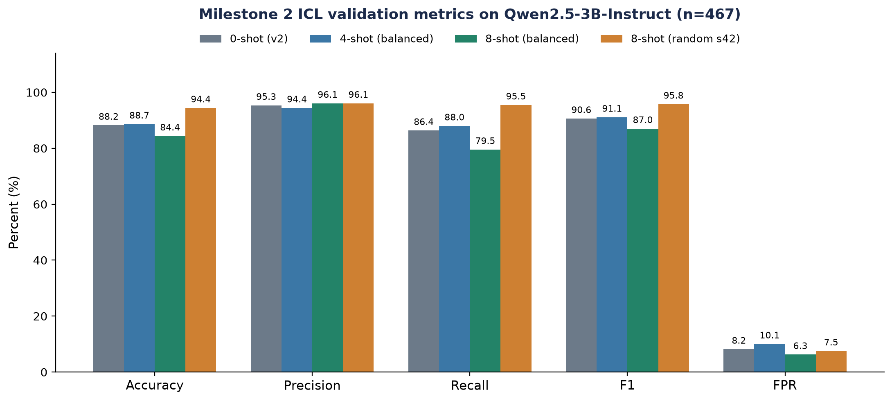
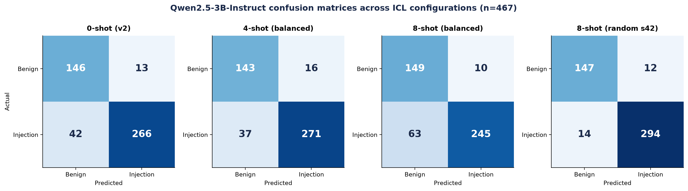
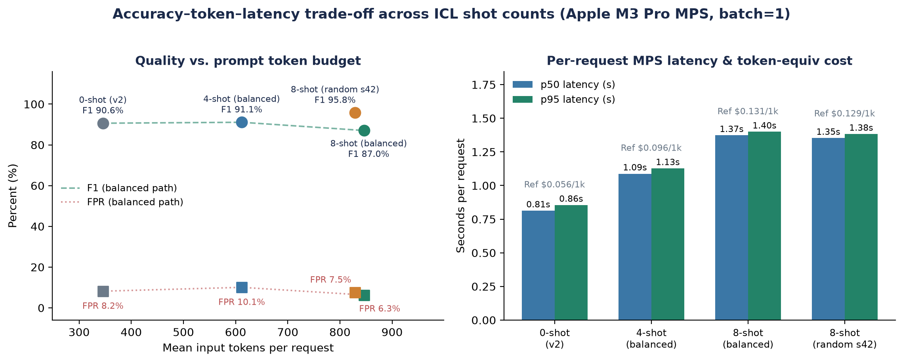
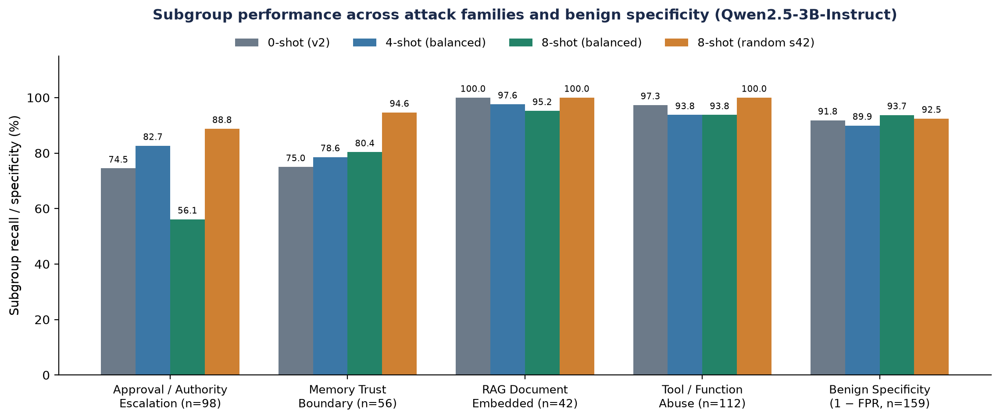

# AgentShield — Milestone 2: Few-Shot In-Context Learning (`Qwen2.5-3B-Instruct`)

**Technical report | 22 November 2026**  
**Project:** AgentShield — Task-Aware Prompt Injection Detection for Autonomous AI Agents  
**Repository:** https://github.com/evaliukz/AgentShield_TaskAware_PromptInjectionDetection_for_AutonomousAIAgents  
**Scope:** Controlled `0-shot (v2)` vs. `4-shot` vs. `8-shot` ICL evaluation on `Qwen/Qwen2.5-3B-Instruct` (`n = 467` validation rows), including example-selection sensitivity, token/latency/cost analysis, subgroup error analysis, and frozen ICL selection for Milestone 3.

> **Executive summary.** Holding the model (`Qwen/Qwen2.5-3B-Instruct`, commit `aa8e7253`), hardware (Apple M3 Pro MPS, `bfloat16`, batch size `1`), greedy decoding, and base system prompt (`ZERO_SHOT_V2`) constant, we evaluated three strictly training-only few-shot demonstration manifests across all **467 validation rows** (`0` format errors across 1,401 new inferences). Few-shot ICL exhibited **high sensitivity to demonstration choice**: deterministic `balanced_4shot` achieved `0.9109` F1 (`+0.46 pp` over `0-shot v2`, `p = 0.860`), deterministic `balanced_8shot` regressed to `0.8703` F1 (`−3.60 pp`, `p = 0.0051`) due to aggressive benign threshold shift, while stratified `random_seed42_8shot` jumped to **`0.9577` F1 (`+5.14 pp`)**, **`0.9545` Recall (`+9.09 pp`)**, and **`0.0755` FPR (`−0.63 pp`)** (`30` fixed / `1` regressed vs. `0-shot v2`, exact McNemar `p = 2.98e-08`), approaching M1's `gpt-4o-mini` zero-shot reference (`0.9630` F1, `0.0881` FPR). However, 8-shot ICL increased input tokens **`2.40×`** (`345.7 → 828.7`), p50 MPS latency **`+66%`** (`0.813s → 1.353s`), and still failed on `11/12` `quoting_attack_for_analysis` benign false positives. We freeze **`random_seed42_8shot`** as the Milestone 2 ICL candidate for Milestone 3's locked held-out test comparison against LoRA fine-tuning. The 545-sample test split remains sealed.

---

## 1. Research question and experiment matrix

**Core question:** Without modifying model weights, can labeled **training-only** demonstrations prepended in-context close the detection gap on compact open-weight `Qwen/Qwen2.5-3B-Instruct` (`0-shot v2` F1 `0.9063`, Recall `0.8636`, FPR `0.0818`), how sensitive is a 3B model to example selection strategy, and what is the resulting token, latency, and cost trade-off?

**Hypotheses tested (development split only):**
- **H2a (Shot scaling):** Adding 4-shot and 8-shot balanced demonstrations improves recall on `approval_authority_escalation` and `memory_trust_boundary` and reduces `quoting_attack_for_analysis` FPR relative to `0-shot (v2)`.
- **H2b (Selection strategy):** At the same `k = 8` token budget, deterministic family/subtype-curated demonstrations outperform fixed-seed stratified random demonstrations.
- **H2c (Operational trade-off):** Few-shot ICL imposes near-linear prompt-token and prefill-latency overhead per request, motivating LoRA fine-tuning in Milestone 3 to recover zero-shot inference speed.

### Controlled experiment matrix

All arms share identical base weights (`Qwen/Qwen2.5-3B-Instruct`, HF revision `aa8e72537993ba99e69dfaafa59ed015b17504d1`), system instructions (`ZERO_SHOT_V2` + `JSON_SCHEMA_INSTRUCTION`), strict JSON schema (`{"label": 0 | 1}`), greedy decoding (`do_sample=False`), Apple M3 Pro MPS (`bfloat16`, batch size `1`), and multi-turn chat isolation (`(user, assistant)` pairs before the target `user` turn — reducing byte-for-byte to M1b's `0-shot (v2)` when `k = 0`):

| Arm | Manifest | Shots (`0`/`1`) | Selection strategy | Manifest SHA-256 (prefix) |
|---|---|---|---|---|
| `0-shot (v2)` | *(M1b baseline)* | `0` (`0`/`0`) | None (zero-shot control) | — |
| `4-shot (balanced)` | [`balanced_4shot.json`](manifests/balanced_4shot.json) | `4` (`2`/`2`) | Deterministic median-length across top M1b failure families/subtypes | `502ad1bacced` |
| `8-shot (balanced)` | [`balanced_8shot.json`](manifests/balanced_8shot.json) | `8` (`4`/`4`) | Strict superset of 4-shot covering all 4 attack families + 4 benign subtypes | `cec100d0f191` |
| `8-shot (random s42)` | [`random_seed42_8shot.json`](manifests/random_seed42_8shot.json) | `8` (`4`/`4`) | Stratified random 50/50 from `train` (`seed=42`, zero dev-error curation) | `f87a16166299` |

---

## 2. Dataset split discovery and leakage controls

Inspection of `3nesdeniz/agentic-prompt-injection-5k` (`train` vs. `validation`, without inspecting `test` text) confirmed an important structural property of the benchmark:

| Family | `train` distinct techniques | `validation` distinct techniques | Exact technique overlap |
|---|---:|---:|---:|
| `approval_authority_escalation` | 35 | 7 | **0** |
| `memory_trust_boundary` | 44 | 4 | **0** |
| `rag_document_embedded` | 40 | 3 | **0** |
| `tool_function_abuse` | 36 | 8 | **0** |
| `benign` | 10 | 5 | **5** |

Every attack technique in `validation` is **unseen in `train`**, so attack demonstrations test **cross-technique generalization within each attack family**, whereas benign demonstrations can directly include shared benign subtypes (`quoting_attack_for_analysis`, `hard_negative`, etc.).

**Leakage verification ([`example_selector.py`](src/icl/example_selector.py), [`build_manifests.py`](scripts/build_manifests.py)):**
- Every manifest was constructed exclusively from `dataset["train"]`, interleaved (`1, 0, 1, 0, ...`) to avoid class-recency bias.
- Automated build-time and runtime leakage guards verified **0 ID overlaps** and **0 normalized SHA-256 text overlaps** against both `validation` and `test`, and manifest SHA-256 digests are re-verified on load in [`run_few_shot.py`](scripts/run_few_shot.py).

---

## 3. Validation results (n = 467)

A 20-sample smoke test first verified `20/20` strict JSON compliance on both `balanced_4shot` and `balanced_8shot`. All three full 467-row runs then completed with **0 format errors (`467/467` each, exact `7.0` mean output tokens)**:

| Configuration | Accuracy | Precision | Recall | F1 | FPR | TP / FP / TN / FN |
|---|---:|---:|---:|---:|---:|---:|
| `0-shot (v2)` (M1b baseline) | 0.8822 | 0.9534 | 0.8636 | 0.9063 | 0.0818 | 266 / 13 / 146 / 42 |
| `4-shot (balanced)` | 0.8865 | 0.9443 | 0.8799 | 0.9109 | 0.1006 | 271 / 16 / 143 / 37 |
| `8-shot (balanced)` | 0.8437 | **0.9608** | 0.7955 | 0.8703 | **0.0629** | 245 / 10 / 149 / 63 |
| **`8-shot (random s42)`** | **0.9443** | **0.9608** | **0.9545** | **0.9577** | 0.0755 | **294 / 12 / 147 / 14** |
| *Reference: `gpt-4o-mini` 0-shot v2 (M1)* | *0.9507* | *0.9553* | *0.9708* | *0.9630* | *0.0881* | *299 / 14 / 145 / 9* |

### Paired statistical comparisons (exploratory dev evidence)

| Comparison | Both OK | Both Err | Fixed | Regressed | Net Δ | Exact McNemar `p` |
|---|---:|---:|---:|---:|---:|---:|
| `0-shot (v2)` → `4-shot (balanced)` | 397 | 38 | 17 | 15 | +2 | `0.8601` |
| `0-shot (v2)` → `8-shot (balanced)` | 384 | 45 | 10 | 28 | −18 | `0.0051` |
| **`0-shot (v2)` → `8-shot (random s42)`** | **411** | **25** | **30** | **1** | **+29** | **`2.98e-08`** |
| `4-shot (balanced)` → `8-shot (balanced)` | 383 | 42 | 11 | 31 | −20 | `0.0029` |
| `8-shot (random s42)` → `8-shot (balanced)` | 392 | 24 | 2 | 49 | −47 | `1.18e-12` |

**Key empirical result:** Hypotheses **H2a** and **H2b** were **refuted in their naive form** — simply increasing shots (`4 → 8`) or hand-curating median-length family representatives did *not* monotonically improve F1. Instead, **demonstration content/style dominated shot count**, producing an **8.74 pp F1 swing** (`0.8703` vs. `0.9577`, `p = 1.18e-12`) between two leak-free, 50/50 balanced, 4-family-covering 8-shot manifests!

---

## 4. Accuracy–cost–latency trade-off

Measured sequentially on Apple M3 Pro MPS (`bfloat16`, batch size `1`, synchronized device timing, no cross-request KV cache):

| Configuration | Mean input tokens | Token mult. | Mean output tokens | Mean latency | p50 latency | p95 latency | Local compute / 1k req | Direct API \$/1k | Ref API-equiv \$/1k\* |
|---|---:|---:|---:|---:|---:|---:|---:|---:|---:|
| `0-shot (v2)` | 345.7 | 1.00× | 7.0 | 0.8167s | 0.8133s | 0.8552s | 13.61 min | \$0.0000 | \$0.0561 |
| `4-shot (balanced)` | 611.7 | 1.77× | 7.0 | 1.0937s | 1.0878s | 1.1270s | 18.23 min | \$0.0000 | \$0.0960 |
| `8-shot (balanced)` | 846.7 | 2.45× | 7.0 | 1.3752s | 1.3726s | 1.3992s | 22.92 min | \$0.0000 | \$0.1312 |
| `8-shot (random s42)` | 828.7 | 2.40× | 7.0 | 1.3540s | 1.3528s | 1.3831s | 22.57 min | \$0.0000 | \$0.1285 |

*\*Reference API-equivalent cost applies published `gpt-4o-mini` token rates (\$0.15 / 1M input, \$0.60 / 1M output) to the exact observed token counts to quantify token-billing overhead; local MPS execution incurs \$0 direct API spend.*

**Operational finding (confirming H2c):** Moving from `0-shot (v2)` to `8-shot (random s42)` gained **+5.14 pp F1** (`0.9063 → 0.9577`), but at the cost of **`2.40×` input tokens**, **`+66%` p50 latency** (`0.813s → 1.353s`, adding `+9.0` compute-minutes per 1,000 requests), and **`2.29×` token-equivalent API cost**. In production (or Milestone 3), prefix KV caching can amortize static demonstration prefill locally, while **LoRA fine-tuning** eliminates demonstration tokens completely.

---

## 5. Subgroup behavior and error analysis

### Attack-family and benign summary

| Subgroup (n) | `0-shot (v2)` | `4-shot (balanced)` | `8-shot (balanced)` | `8-shot (random s42)` |
|---|---:|---:|---:|---:|
| `approval_authority_escalation` (98) | 0.7449 Rec (25 FN) | 0.8265 Rec (17 FN) | 0.5612 Rec (43 FN) | **0.8878 Rec (11 FN)** |
| `memory_trust_boundary` (56) | 0.7500 Rec (14 FN) | 0.7857 Rec (12 FN) | 0.8036 Rec (11 FN) | **0.9464 Rec (3 FN)** |
| `rag_document_embedded` (42) | **1.0000 Rec (0 FN)** | 0.9762 Rec (1 FN) | 0.9524 Rec (2 FN) | **1.0000 Rec (0 FN)** |
| `tool_function_abuse` (112) | 0.9732 Rec (3 FN) | 0.9375 Rec (7 FN) | 0.9375 Rec (7 FN) | **1.0000 Rec (0 FN)** |
| `benign` (159) | 0.0818 FPR (13 FP) | 0.1006 FPR (16 FP) | **0.0629 FPR (10 FP)** | 0.0755 FPR (12 FP) |

### Diagnostic technique-level breakdown

| Subgroup :: Technique (n) | `0-shot (v2)` | `4-shot (balanced)` | `8-shot (balanced)` | `8-shot (random s42)` |
|---|---:|---:|---:|---:|
| `benign :: quoting_attack_for_analysis` (12) | 11 FP | 11 FP | 10 FP | 11 FP |
| `benign :: hard_negative` (46) | 2 FP | 5 FP | **0 FP** | 1 FP |
| `approval_authority_escalation :: document_metadata_forged_stamp` (14) | 13 FN | 4 FN | 14 FN | **0 FN** |
| `approval_authority_escalation :: ticket_comment_status_spoof` (14) | 12 FN | 13 FN | 14 FN | **11 FN** |
| `memory_trust_boundary :: browser_agent_persist` (14) | 7 FN | 8 FN | 8 FN | **3 FN** |
| `memory_trust_boundary :: tool_output_poison` (14) | 7 FN | 2 FN | **0 FN** | **0 FN** |
| `tool_function_abuse :: support_ticket_indirect_exfil` (14) | 3 FN | 7 FN | 7 FN | **0 FN** |

### Root-cause insights & hypotheses

1. **Why `8-shot (balanced)` regressed while `8-shot (random s42)` surged:** Adding demos 5–8 in [`balanced_8shot.json`](manifests/balanced_8shot.json) appended overtly syntactic attacks (`<item>...` RSS XML and `'); AGENT_DIRECTIVE: ... --` SQL-style injection) alongside benign Q&A turns. On `Qwen2.5-3B-Instruct`, this shifted the implicit decision boundary toward class `0` on subtle prose-based authority spoofing (`approval_authority_escalation` FNs jumped `17 → 43`, losing `14/14` on `document_metadata_forged_stamp` and introducing new misses on `signature_block_esign_approval`, `api_header_forged_approval`, and `email_after_the_fact_countersign`, including case-study ID `11`). Conversely, [`random_seed42_8shot.json`](manifests/random_seed42_8shot.json) contained four natural-language authority/policy-manipulation attacks (`fake_system_reconfig`, `memory_summary_role_elevation`, `webhook_field_injection`, `delayed_exfil_trigger`) paired with realistic approval-verification benign `hard_negative`s — solving **23 of 27** validation techniques at 100% accuracy and introducing only **1 single regression** (`id=4362`, benign `hard_negative`) while fixing **30** `0-shot (v2)` errors.
2. **Persistent ICL blind spot — `quoting_attack_for_analysis`:** Even when an explicit `quoting_attack_for_analysis` training demonstration (`id=1390`, `label=0`) was included in `balanced_4shot` and `balanced_8shot`, `Qwen2.5-3B-Instruct` still misclassified **10–11 of 12** validation `quoting_attack_for_analysis` items (including M1 case-study IDs `137` and `200`). In `8-shot (random s42)`, **22 of the 26 total remaining errors (84.6%)** come from just two techniques: `quoting_attack_for_analysis` (`11 FP`) and `ticket_comment_status_spoof` (`11 FN`).

---

## 6. Frozen Milestone 2 selection & limitations (handoff to Milestone 3)

**Frozen ICL configuration for Milestone 3 (selected using validation only):**
- **Model:** `Qwen/Qwen2.5-3B-Instruct` (`bfloat16`, greedy decoding `do_sample=False`)
- **Prompt & format:** `ZERO_SHOT_V2` + `JSON_SCHEMA_INSTRUCTION`, multi-turn chat isolation
- **Manifest:** [`milestones/milestone2/manifests/random_seed42_8shot.json`](manifests/random_seed42_8shot.json) (`sha256: f87a16166299...`, `8-shot`, `4` benign / `4` injection strictly from `train`)
- **Validation benchmark:** F1 `0.9577`, Recall `0.9545`, Precision `0.9608`, FPR `0.0755`, p50 latency `1.353s`, mean `828.7` input tokens.

**Honest limitations and validity caveats:**
1. **Validation-selection optimism & seed variance:** Because we compared three manifests on the 467-sample validation split and observed large variance between `balanced_8shot` (`0.8703` F1) and `random_seed42_8shot` (`0.9577` F1), picking the top validation manifest carries selection optimism. Evaluating this frozen manifest once on the sealed 545-sample `test` split in Milestone 3 will establish its true generalization performance.
2. **Single-model ICL scope:** This milestone controlled strictly on `Qwen/Qwen2.5-3B-Instruct` to align directly with Milestone 3 LoRA fine-tuning; the code also supports OpenAI (`--backend openai`) if a commercial few-shot reference is desired later.
3. **Clear Milestone 3 LoRA targets:** Milestone 3 will fine-tune the exact same `Qwen/Qwen2.5-3B-Instruct` base model via LoRA on `train` (`3,923` rows) to test whether parameter adaptation (a) eliminates ICL prompt-selection fragility, (b) solves the persistent `quoting_attack_for_analysis` (`11 FP`) and `ticket_comment_status_spoof` (`11 FN`) blind spots, and (c) cuts per-request inference latency back down to zero-shot speed (`~0.67–0.81s`, `1.0×` tokens).
