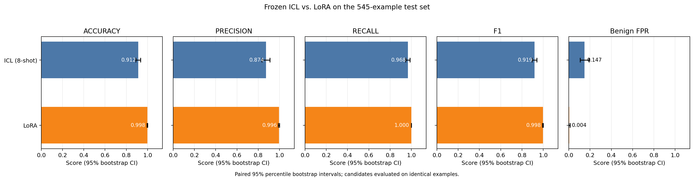
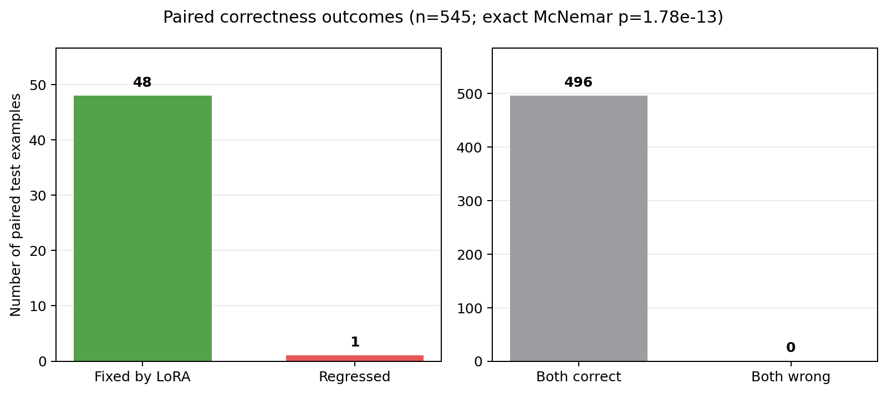
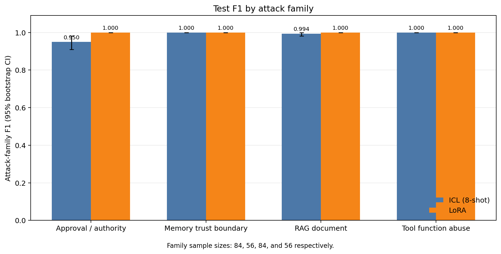

# AgentShield — Milestone 3: LoRA Fine-Tuning and Paired Evaluation

**Technical report | 22 November 2026**  
**Project:** AgentShield — Task-Aware Prompt-Injection Detection for Autonomous AI Agents  
**Scope:** Supervised LoRA fine-tuning of `Qwen/Qwen2.5-3B-Instruct`, followed by a validation-selected, one-time paired comparison against the frozen Milestone 2 8-shot ICL candidate.

> **Executive summary.** We fine-tuned the pinned Qwen 2.5 3B instruction model with LoRA on the benchmark's 3,923 training examples, selected the checkpoint with the lowest validation loss, and froze that adapter alongside M2's `random_seed42_8shot` ICL configuration. On the same 545 held-out test examples, evaluated once after both candidates were frozen, LoRA achieved **0.9982 F1**, **1.0000 recall**, and **0.0038 FPR**, compared with **0.9186 F1**, **0.9679 recall**, and **0.1472 FPR** for ICL. LoRA corrected 48 ICL errors and introduced 1 regression; the exact two-sided McNemar test gave `p = 1.78e-13`. A 10,000-resample paired bootstrap estimated a 95% confidence interval of **[+0.0580, +0.1037]** for the F1 difference and **[−0.1875, −0.1012]** for the FPR difference. These results favor LoRA on this fixed benchmark test set; they do not establish perfect future performance or robustness to distribution shift. No model or prompt changes were made based on test results.

---

## 1. Research question

**Does supervised parameter-efficient fine-tuning improve prompt-injection classification relative to in-context learning when the base model, prompt, output contract, and evaluation examples are held constant?**

Milestone 2 selected a training-only, stratified random 8-shot ICL manifest using validation performance. Milestone 3 tests whether adapting the same base model's weights with LoRA can improve the quality of that frozen ICL candidate, while also documenting the inference trade-offs and limits of the comparison.

### Questions examined

- **Detection quality:** How do attack precision, recall, F1, accuracy, and benign false-positive rate compare?
- **Error complementarity:** Which candidate fixes the other's mistakes, and how often does it introduce regressions?
- **Subgroups:** Do results differ across the benchmark's attack families and benign examples?
- **Operational trade-offs:** How do validation inference latency and prompt-token counts compare on the shared GPU setup?

The final test phase was descriptive and confirmatory for the frozen candidates. It was not used for model selection, threshold adjustment, prompt editing, or further training.

---

## 2. Dataset and evaluation protocol

The experiments use the Hugging Face benchmark `3nesdeniz/agentic-prompt-injection-5k`, pinned to dataset revision `37ecd4e7962f6160509752c57379301904f806ac`.

| Split | Samples | Role |
|---|---:|---|
| Train | 3,923 | LoRA training and M2 demonstration selection |
| Validation | 467 | Checkpoint selection and development comparisons |
| Test | 545 | One-time paired evaluation after both candidates were frozen |

The task is binary text classification: `0 = benign`, `1 = prompt injection`. Both candidates use the pinned `Qwen/Qwen2.5-3B-Instruct` revision `aa8e72537993ba99e69dfaafa59ed015b17504d1` and the effective `ZERO_SHOT_V2` system prompt. The model returns the strict JSON label shape `{"label": 0}` or `{"label": 1}`.

The LoRA training runner loaded only the pinned train and validation files, validated their rows and checked for ID overlap. Training metadata records `test_split_accessed: false`. A failed early pilot using a generic dataset loader materialized test data in a local cache, but stopped during train-example tokenization before model loading or training. It did not use test examples for training, checkpoint selection, or evaluation. The corrected split-specific loader fetches train and validation during development; test loading requires an explicit final-evaluation opt-in.

For the final comparison, both frozen candidates completed all 545 test rows without inference failures and shared the same sample-ID SHA-256:

`b0a4d21d48e0bf7a6fc506324f1a7e4992cbed64daa906ae93be7b30a439b18f`

Both test runs used CUDA, bfloat16, greedy decoding (`do_sample=False`), and `max_new_tokens=24`. The paired evaluator verifies that the runs match on split, sample count, sample IDs, dataset and model revisions, prompt hash, dtype, device, and decoding limit before comparing predictions.

---

## 3. Methods

### 3.1 LoRA fine-tuning

The training target is the assistant completion containing the JSON label. The causal-language-model loss is masked over system and user prompt tokens and computed only over the target assistant completion.

| Setting | Value |
|---|---|
| Base model | `Qwen/Qwen2.5-3B-Instruct` |
| Training examples | 3,923 |
| Validation examples | 467 |
| Hardware | NVIDIA A10G |
| Training precision | bfloat16 |
| Maximum sequence length | 512 tokens |
| Epochs / optimizer steps | 3 / 1,473 |
| Seed | 42 |
| Learning rate | `1e-4` |
| Per-device batch / gradient accumulation | 1 / 8 |
| Scheduler / warmup | Cosine / 3% |
| Weight decay | 0.01 |
| LoRA rank / alpha / dropout | 8 / 16 / 0.05 |
| LoRA target modules | `q_proj`, `k_proj`, `v_proj`, `o_proj`, `gate_proj`, `up_proj`, `down_proj` |
| Checkpoint selection | Lowest validation loss; early-stopping patience 2 |

The selected checkpoint was `checkpoint-491` (epoch 1), with validation loss `0.0003891`. Epoch 2 and epoch 3 validation losses were `0.0006505` and `0.0007722`, respectively. The selected checkpoint was saved as the best adapter and was not changed after validation selection.

### 3.2 Frozen ICL comparator

The comparator is the M2 `random_seed42_8shot` manifest, selected using validation only. Its eight demonstrations were sampled from training data. For the fair paired GPU comparison, the frozen ICL configuration was freshly evaluated on the same runtime and split as LoRA; the historical M2 report's MPS metrics are therefore not substituted for the fresh paired-validation results.

### 3.3 Metrics and uncertainty

We report accuracy, precision, attack recall, attack F1, and FPR on benign examples. Paired error counts distinguish cases fixed by LoRA from regressions relative to ICL. The exact two-sided McNemar test is applied to discordant correctness outcomes.

For the test comparison, 95% percentile confidence intervals were computed using **10,000 paired nonparametric bootstrap resamples**. Each resample preserves the pairing between candidates for each sampled row. Overall resampling uses seed 42; family resampling uses deterministic family-specific seeds. These intervals describe sampling uncertainty under this test-set design, not uncertainty from dataset shift, annotation error, or new populations.

---

## 4. Validation results — development evidence

Validation results supported checkpoint selection and development comparison; they are not the final generalization estimate.

| Candidate | Accuracy | Precision | Recall | F1 | FPR |
|---|---:|---:|---:|---:|---:|
| Frozen 8-shot ICL | 0.9422 | 0.9547 | 0.9578 | 0.9562 | 0.0881 |
| LoRA, selected epoch 1 | 0.9979 | 0.9968 | 1.0000 | 0.9984 | 0.0063 |
| LoRA minus ICL | +5.57 pp | +4.21 pp | +4.22 pp | +4.21 pp | −8.18 pp |

Across 467 paired validation examples, LoRA corrected 26 ICL errors, introduced no regressions, and both candidates were wrong on one example. The exact McNemar p-value was `2.98e-08`. Improvements included `approval_authority_escalation` (F1 `0.9405 → 1.0000`) and `memory_trust_boundary` (`0.9818 → 1.0000`). Benign FPR decreased from 14/159 to 1/159. Both candidates were perfect on the validation `rag_document_embedded` and `tool_function_abuse` subgroups.

### Validation inference trade-off

Measured on the shared CUDA/bfloat16 A10G setup:

| Candidate | Mean input tokens | Mean output tokens | Mean latency |
|---|---:|---:|---:|
| Frozen 8-shot ICL | 828.7 | 7.0 | 0.3035 s |
| LoRA | 345.7 | 7.0 | 0.4925 s |

In this sequential single-example setup, LoRA used about 58% fewer mean input tokens but had about 62% higher mean latency. This is a measured runtime result for this specific setup, not an end-to-end serving benchmark. No monetary serving-cost claim is made.

---

## 5. Final paired test results — one-time evaluation

| Candidate | Accuracy | Precision | Recall | F1 | FPR |
|---|---:|---:|---:|---:|---:|
| Frozen 8-shot ICL | 0.9119 | 0.8742 | 0.9679 | 0.9186 | 0.1472 |
| Frozen LoRA | **0.9982** | **0.9964** | **1.0000** | **0.9982** | **0.0038** |
| LoRA minus ICL | +8.62 pp | +12.22 pp | +3.21 pp | +7.96 pp | −14.34 pp |

| Candidate | TP | FP | TN | FN |
|---|---:|---:|---:|---:|
| Frozen 8-shot ICL | 271 | 39 | 226 | 9 |
| Frozen LoRA | 280 | 1 | 264 | 0 |

LoRA corrected 48 ICL errors and regressed on 1. There were 496 examples on which both were correct and 0 on which both were wrong. The exact two-sided McNemar test gave `p = 1.78e-13`. This statistic tests paired disagreement in correctness on this sample; it does not establish performance on other benchmarks.

### 5.1 Overall 95% paired bootstrap intervals

| Metric | ICL 95% CI | LoRA 95% CI | LoRA − ICL 95% CI |
|---|---:|---:|---:|
| Accuracy | [0.8881, 0.9339] | [0.9945, 1.0000] | [+0.0642, +0.1119] |
| Precision | [0.8354, 0.9097] | [0.9888, 1.0000] | [+0.0861, +0.1613] |
| Recall | [0.9458, 0.9862] | [1.0000, 1.0000] | [+0.0138, +0.0542] |
| F1 | [0.8946, 0.9400] | [0.9944, 1.0000] | [+0.0580, +0.1037] |
| FPR | [0.1065, 0.1910] | [0.0000, 0.0119] | [−0.1875, −0.1012] |

### 5.2 Attack-family results

| Attack family | n | ICL F1 / recall | LoRA F1 / recall | F1 difference, LoRA − ICL (95% CI) |
|---|---:|---:|---:|---:|
| `approval_authority_escalation` | 84 | 0.9500 / 0.9048 | 1.0000 / 1.0000 | +0.0500 [0.0182, 0.0909] |
| `memory_trust_boundary` | 56 | 1.0000 / 1.0000 | 1.0000 / 1.0000 | 0.0000 [0.0000, 0.0000] |
| `rag_document_embedded` | 84 | 0.9940 / 0.9881 | 1.0000 / 1.0000 | +0.0060 [0.0000, 0.0182] |
| `tool_function_abuse` | 56 | 1.0000 / 1.0000 | 1.0000 / 1.0000 | 0.0000 [0.0000, 0.0000] |

The benign subgroup contained 265 examples. ICL produced 39 false positives (FPR `0.1472`); LoRA produced 1 (FPR `0.0038`). The paired 95% bootstrap interval for the FPR difference was `[−0.1887, −0.1019]`.

The subgroup estimates should be interpreted with their sample sizes in mind. In particular, perfect observed scores on a subgroup do not imply zero population error; the intervals and point estimates are benchmark-sample evidence.

---

## 6. Interpretation

On the fixed test set, the frozen LoRA candidate improved all reported aggregate quality metrics relative to the frozen ICL candidate. The largest operationally relevant difference was the reduction in benign false positives, from 39 to 1. LoRA also recovered the nine ICL false negatives while correctly detecting all 280 attack examples in this sample. The attack-family results show the most visible gain in `approval_authority_escalation`; both candidates already scored perfectly on the observed `memory_trust_boundary` and `tool_function_abuse` rows.

The test findings are consistent with the direction of the paired validation results, but the test F1 and FPR are not the same as validation results. That is expected: the splits contain different examples and proportions. The historical M2 report's Apple MPS score is also not the comparator used here. The paired comparison uses fresh M2 predictions generated under the shared CUDA/bfloat16 protocol, which is why the development comparison in this report should be preferred for ICL-versus-LoRA validation conclusions.

LoRA's lower prompt-token count did not translate into lower measured per-example latency in the available A10G setup. This result is consistent with the fact that parameter adaptation reduces prompt length but does not remove model forward-pass work, and it should not be generalized into a serving-performance conclusion without a controlled throughput/serving benchmark.

---

## 7. Limitations and threats to validity

1. **One benchmark and one held-out sample.** The comparison uses one dataset revision and one fixed test split. It does not establish robustness to new domains, languages, adversarial distributions, or deployment traffic.
2. **Dataset composition and synthetic patterns.** Results may reflect the benchmark's generation, labeling, and family distribution. Template or semantic overlap not detected by the available checks may still affect generalization.
3. **Small subgroup sizes.** Attack-family test counts range from 56 to 84. Observing no errors in a subgroup is not evidence that the underlying error probability is zero.
4. **Validation-based model selection.** The LoRA checkpoint was selected from epoch checkpoints by validation loss; the ICL manifest was selected on validation among multiple candidates. Both selection processes can introduce optimism. The single test comparison is intended to provide a final estimate for these frozen candidates, not an unbiased evaluation of an entire model-selection procedure.
5. **No test-driven iteration.** Test outputs were used only for the paired report. Neither model, prompt, threshold, nor configuration was changed or selected based on the test result.
6. **Incomplete training-cost accounting.** The run metadata reports cumulative training time of approximately 4,174 seconds and peak allocated GPU memory of approximately 7.36 GB (reserved: approximately 13.86 GB). However, the original epoch-1 segment runtime was not captured in the metadata across resumptions, so the recorded cumulative duration is not a complete end-to-end training-cost estimate. No cloud billing total is available here.
7. **Latency scope.** Inference latency was measured sequentially on one A10G setup. It does not include realistic batching, concurrent load, service overhead, cold starts, network latency, or tail-latency behavior under production load.
8. **Text classification only.** This benchmark measures whether input text is labeled as an injection. It does not establish that an autonomous agent will be secure; enforcement should rely on independent deterministic authorization and least-privilege controls, not a detector label alone.

---

## 8. Reproducibility and artifacts

Key experiment details are recorded in the run metadata and comparison outputs:

- Training configuration and checkpoint selection: `artifacts/lora-qwen2.5-3b/run_config.json`
- LoRA validation predictions and runtime metadata: `data/reports/lora_validation_best_adapter.csv` and its JSON sidecar
- LoRA test predictions and runtime metadata: `data/reports/lora_test_best_adapter.csv` and its JSON sidecar
- Fresh paired ICL validation predictions: `milestones/milestone2/data/reports/`
- Frozen ICL test predictions: `milestones/milestone2/data/reports/few_shot_qwen2.5-3b-instruct_v2_random_seed42_8shot_test.csv`
- Full test comparison, changed predictions, family metrics, and uncertainty: `data/reports/lora_vs_icl_test.json`
- Training implementation: [`train_lora.py`](scripts/train_lora.py)
- Evaluation implementation: [`evaluate_lora.py`](scripts/evaluate_lora.py)
- Paired comparison and bootstrap implementation: [`compare_lora.py`](scripts/compare_lora.py)
- Report figure generation: [`plot_milestone3.py`](scripts/plot_milestone3.py); PNGs are in [`assets/`](assets/)
- Shared task formatting, masked loss, and split checks: [`training.py`](src/training.py)
- Split-specific pinned dataset loader: [`dataset.py`](../milestone2/src/icl/dataset.py)
- Frozen ICL selection rationale and development study: [`Milestone 2 report`](../milestone2/Milestone2Report.md)

Generated prediction and model artifacts may be locally stored and excluded from version control; the report records the key metrics and configuration needed to interpret the experiment.

---

## 9. Conclusion

Under the controlled protocol used here, the validation-selected LoRA adapter outperformed the frozen 8-shot ICL candidate on the paired 545-example test set, with a higher F1 and recall and a substantially lower false-positive rate. Paired error analysis found 48 ICL mistakes corrected by LoRA and one regression, while the paired bootstrap intervals for the overall F1 and FPR differences excluded zero in the observed directions.

The conclusion is specific to these frozen candidates and this benchmark test split. It should not be paraphrased as “LoRA is perfect” or as a guarantee of production security. Further claims require evaluation on independent datasets and realistic agent workflows, while runtime security should combine detection with explicit authorization controls.

## Appendix: concise results

| Split | Candidate | n | Accuracy | Precision | Recall | F1 | FPR |
|---|---|---:|---:|---:|---:|---:|---:|
| Validation | Frozen 8-shot ICL | 467 | 0.9422 | 0.9547 | 0.9578 | 0.9562 | 0.0881 |
| Validation | LoRA, checkpoint 491 | 467 | 0.9979 | 0.9968 | 1.0000 | 0.9984 | 0.0063 |
| Test | Frozen 8-shot ICL | 545 | 0.9119 | 0.8742 | 0.9679 | 0.9186 | 0.1472 |
| Test | Frozen LoRA | 545 | 0.9982 | 0.9964 | 1.0000 | 0.9982 | 0.0038 |
